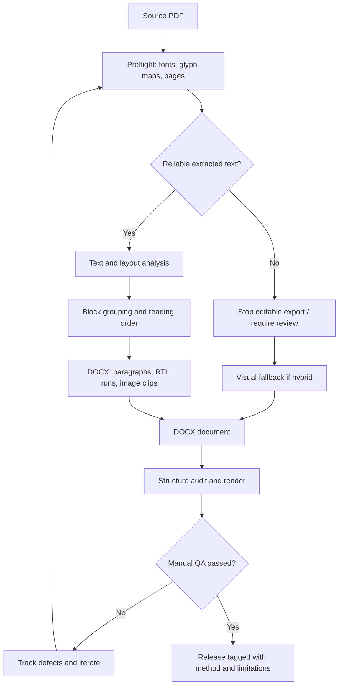

# هندسة نظام PDF → DOCX

## الهدف الحقيقي
تحقيق **ثلاثة محاور مستقلة**: 1) صحة النص، 2) قابلية تعديله، 3) درجة وفاء المظهر. لا يجوز اعتبار نجاح أحدها نجاحًا للآخرين.

## Pipeline

## Units of work

| Component | Input | Output | Main failure mode | Current state |
| --- | --- | --- | --- | --- |
| Font diagnostics | PDF glyph maps, spans | Unicode anomaly report | Legacy Arabic embedded fonts produce control chars/Latin symbols | Implemented, heuristic |
| Layout detection | `block.bbox`, page geometry | Ordered elements | Sidebars and columns interleave | Simple Y/RTL sort only |
| Paragraph grouping | Lines belonging to one block | DOCX paragraph | Every PDF line becomes a separate paragraph with wrong spacing | Block lines merged |
| Direction | Arabic and Latin runs | Word OOXML `w:bidi`, `w:rtl` | Parentheses/numbers mirrored or moved | Initial implementation; needs examples |
| Tables | Borders, cell polygons, glyph locations | Native Word table | Rasterized or flattened tables | Not implemented |
| Figures | Raster/vector drawings | Crop or native drawing | Figure lost/duplicated/overlaps | Raster image clips only |
| Geometry/typography | Font metrics, margins, styles | Page styles/sections | Font reflow, wrong spacing, false page breaks | Initial style; not pixel faithful |
| Output audit | DOCX & source | JSON warnings; optional rendered page count | Silent corrupt content or wrong page count | Initial implementation |
| Visual diff | Rendered PDF/DOCX page pair | Region metrics and manual sign-off | Similar text with unusable layout | Roadmap |

## Source of truth

PDF **rendered image** is authoritative for appearance. Its extracted text stream is *not* authoritative for spelling or logical order if mapping is faulty. Any repair must identify the exact source font, glyph, location and original visual verification. Avoid unconditional replacements such as `7→س` (may corrupt numbers) or rewriting words from language-model guesses without human verification.

## Conversion contracts

- `visual`: one embedded page image, a truthful **image-only DOCX**.
- `editable`: paragraph-based Word output **only if** all selected source pages pass Unicode preflight. Explicit override allowed for experiments, never silently.
- `hybrid`: editable for Unicode-clean pages, otherwise full-page visual fallback. Warning in per-page report. **Mixed editability.**

## Precise QA tasks for future versions

1. PDF and DOCX rendering at fixed DPI (prefer 150–200); compare pages geometrically.
2. Segment regions: header, footer, main, table, sidebar, photo/figure, caption.
3. Extract known ground-truth Arabic strings from rendered page, verify harakat, hamza, ligatures and punctuation; log Character Error Rate and Word Error Rate if truth exists.
4. Count editable paragraphs/tables/drawings; image-only pages cannot satisfy editability target.
5. Review each page at 100% in actual Word or Word in Chat; log difference and fix, then re-render after every batch.
6. Record Word version, available fonts, page size, font fallback and original DPI so results are reproducible.

## Integration with Word in Chat

Word in Chat can be used as the **manual review/edit stage**: upload a generated DOCX, inspect pages, repair questionable passages, export the revision, then compare and record the changes as a new experiment. It does not replace font-map analysis, reliable source extraction, or objective render checks. No automatic plugin invocation is assumed in the repository's Python CLI.
